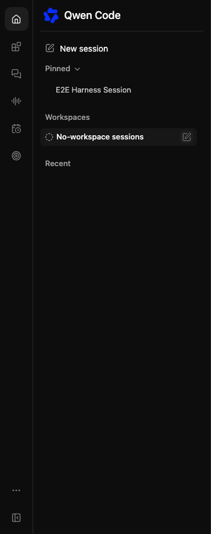
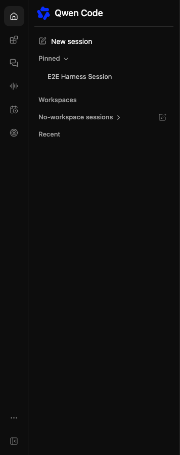

# Web Shell デーモンアダプター

## 目標

Web チャットと Web ターミナルクライアントは、デーモンの HTTP/SSE API を通じて `qwen serve` を利用し、クライアント側でトランスクリプトを描画する必要があります。ネイティブのローカル TUI、チャネル、IDE 統合は、当面は既存のデフォルトパスを維持します。

## インターフェースの用語

この用語の更新は、サイドバーのワークスペース見出しとワークスペースの作成・管理ラベル、通常のセッション作成アクション（ワークスペース概要と共有 Managed ワークスペース行アクションを含む）、Recent 見出し、およびワークスペースの Memory スコープを対象としています。これらの表面では、ラベルは **Workspaces / 工作区**、**New session / 新建会话**、および **Recent / 最近** を使用し、単一のディレクトリバックのエントリは **Workspace / 工作区** を使用します。Memory スコープは **Workspace / 工作区级** を使用し、中国語のスコープレベルの接尾辞を保持します。

これはプロダクト全体の用語移行ではありません。既存の Managed-agent ページのコピーと登録ダイアログのコピー（工作空间 を含む）、session-source の **Tasks / 任务** タブ、ワークスペース実行ヒント、オフラインホストヒント、およびその他のセッションヘルプテキストは既存の文言を保持します。Agent、Skills、Workflow、MCP、および承認スコープラベルはこの更新の対象外です。スケジュールされたタスク、todo アイテム、エージェント/ツールの実行、外部サービスのプロジェクト、および Git ワークツリーはそれぞれのドメインの意味を保持します。**No-workspace sessions / 无工作区会话** グループは名前と配置を保持し、その命名と階層は別のフォローアップ作業です。

既存の翻訳キー、SDK/API フィールド、保存された識別子、設定キー、およびランタイムロジックは変更されません。ラベルから派生した DOM 値は変更され、ダイアログの `aria-label`、`data-web-shell-dialog-title`、およびボタンのアクセシブル名が含まれます。古いテキストにマッチングする自動化はセレクターを更新する必要があります。たとえば、ダイアログタイトルは **Add Workspace** ではなく **Add workspace** になりました。サイドバートリガー、ダイアログ見出し、および非ブラウズの送信ボタンはすべて **Add workspace** を使用し、トリガーと区別するためにスコープテキストベースのダイアログセレクターを `[data-web-shell-dialog]` に設定します。Recent 見出しとそのリージョン名は同じ翻訳キーを共有し続け、個別の説明リージョンラベルはこのコピーのみの更新の対象外です。

## サイドバーのカテゴリヘッダー

Pinned、Workspaces、No-workspace sessions、および Recent は同格の折りたたみ可能なカテゴリです。アクティブなサイドバーヘッダーは、ホバーとキーボードフォーカスの表示ルールを含め、同じ高さ、スペーシング、ミュートテキスト、および末尾の拡張チェブロンを使用します。No-workspace sessions は独立した保存された拡張設定と検索動作を保持します。Archived 設定のそのヘッダーはワークスペースエントリの表示を保持します。

シミュレートされたデーモンレスポンスによる Chromium 比較（折りたたまれた No-workspace sessions カテゴリにホバー）：

| 変更前                                                                     | 変更後                                                                   |
| -------------------------------------------------------------------------- | ----------------------------------------------------------------------- |
|  |  |

## 共有 UI 契約

TypeScript SDK のデーモン UI エクスポートを共通の境界として使用します。

```ts
import {
  DaemonClient,
  DaemonSessionClient,
  createDaemonTranscriptStore,
  normalizeDaemonEvent,
} from ' @qwen-code/sdk/daemon';
```

役割は次のように分割されます。

- `DaemonClient` はデーモンの HTTP ルートを処理します。
- `DaemonSessionClient` はセッションの作成・アタッチと SSE リプレイを管理します。
- `normalizeDaemonEvent()` はデーモンのワイヤイベントを UI イベントに変換します。
- `createDaemonTranscriptStore()` は UI イベントをトランスクリプトブロックに集約します。

React クライアントでは、Web Shell がエクスポートするバインディングを使用できます。

```tsx
import {
  DaemonSessionProvider,
  useActions,
  useConnection,
  usePendingPermissions,
  useTranscriptBlocks,
} from ' @qwen-code/web-shell/daemon-react-sdk';
```

最小限の React 構成。

```tsx
function App() {
  return (
    <DaemonSessionProvider baseUrl="http://127.0.0.1:4170">
      <Transcript />
      <PromptBox />
    </DaemonSessionProvider>
  );
}

function Transcript() {
  const blocks = useTranscriptBlocks();
  return blocks.map((block) => <RenderBlock key={block.id} block={block} />);
}
```

プロバイダーはデーモンセッションの作成またはアタッチを行い、SSE を購読し、`DaemonSessionClient` に最後のイベント ID を保持し、デフォルトでストリームを再接続します。呼び出し側は、テストやカスタム接続管理のために `autoReconnect={false}` でこれを無効にできます。

### 選択したセッションの削除

セッション概要は、100 個を超える選択されたセッションの削除をサポートします。選択を所有ワークスペースごとにグループ化し、各ワークスペースのクライアントを通じて最大 100 個のセッション ID の順次リクエストを送信します。後続のリクエストが失敗した場合でも、削除された現在のセッションのクリーンアップを含め、成功した削除は記録され、失敗は概要に表示されます。

バッチサイズは、ワークスペース限定ルートを含む、セッション削除とアーカイブのデーモンの共有 100-ID リクエスト検証に従います。削除中、セッションごとおよびリクエストごとの失敗は、順序に関係なく、バッチとワークスペースを越えて保持されます。拒否されたリクエストは、そのワークスペースの残りのバッチを停止しますが、他のワークスペースグループは引き続き処理されます。

### composer の添付ファイルの削除

デスクトップ Web Shell の composer で、テキスト本文が空かつキャレットが先頭にあり選択範囲がない場合、Backspace または Delete はまず、そのキーの既存の順序を使って削除可能なコンテキストタグを 1 つ削除します。削除可能なコンテキストタグが残っていない場合は、最後のファイル添付を削除し、ファイルがない場合は最後に貼り付けられた画像を削除します。テキスト本文が空でない間はファイルと画像の添付は保持されます。添付ファイルは個別の削除ボタンを使って削除することもできます。

## ブラウザデプロイ形態

### 同じオリジンのローカル POC

デーモンが提供するページは、ページと API が同じオリジンを共有するため、デーモンを直接呼び出せます。これはローカルの Web チャットと Web ターミナルの検証において、初期の POC として推奨される形態です。

### リモート Web チャット / Web ターミナル

本番環境のリモート Web アプリは、通常 backend-for-frontend と通信する必要があります。BFF はデーモン URL、トークン、ワークスペースルーティング、セッションメタデータを管理し、ブラウザセーフなアプリイベントをブラウザに転送します。これにより、bearer トークンをブラウザストレージに保存せず、デプロイメントごとにユーザーがアクセスできるデーモンとワークスペースを制御できます。

### ローカルデーモンに対するローカルブラウザ

別のローカル開発サーバーは `qwen serve` とクロスオリジンになるため、デーモンルートを同じオリジンでプロキシするか、デーモンから配信される必要があります。デーモンは任意のブラウザ `Origin` リクエストを意図的に拒否します。

## 描画の責務

Web Shell は、ユーザーメッセージ内の `/review` のような行頭の slash トークンを、composer と同じ青・太字で強調表示します。強調表示は記録されたテキストから導出されるため、セッションを再度開く際にも適用されます。これは構文上の手がかりであり、コマンドが存在する、または実行されたことの確認ではありません。メッセージテキスト、クリック可能な URL、アノテーション付き参照 chip は保持されます。

共有トランスクリプトモデルはセマンティックであり、ビジュアルではありません。UI クライアントが描画方法を決定します。

- ユーザーとアシスタントのメッセージブロック
- 折りたたまれた思考ブロック
- ツールステータスカード
- シェル出力ブロック
- 権限リクエストコントロール
- ステータス・エラー・デバッグブロック

Web ターミナルはブラウザネイティブのセマンティックレンダラーです。モノスペースレイアウト、スクロールバック、プロンプト入力、ショートカット、ストリーミングブロックによりターミナルのような見た目と操作性を提供しますが、生の PTY プロキシではなく、サーバー側の Ink 描画も必要としません。

## マージの安全性

- ネイティブの `qwen` TUI は直接動作のまま変更されません。
- `--acp`、チャネル、IDE パスはデフォルトで変更されません。
- SDK UI コアは追加のみです。
- Web Shell React バインディングはオプションであり、それをインポートするクライアントでのみ動作します。
- 削除されたデーモン TUI のスパイクコードは、プロダクト移行として扱うべきではありません。

## 今後の対応

- デーモンが提供する Web Shell と埋め込み IDE ホストの動作を整合させてください。
- トランスクリプトブロック上にファーストクラスのチャットとターミナルレンダラーの構築を継続してください。
- 既存のデーモンイベントが安定したブラウザ UI 動作には低すぎる場合にのみ、より豊富な型付きイベントを追加してください。
- SDK 以外の利用者が UI コアを独立した依存関係として必要とする場合、専用の `@qwen-code/daemon-ui-core` パッケージを検討してください。