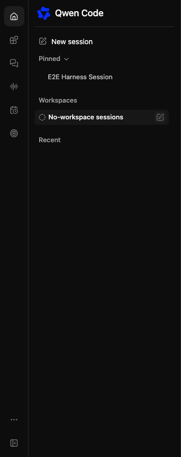
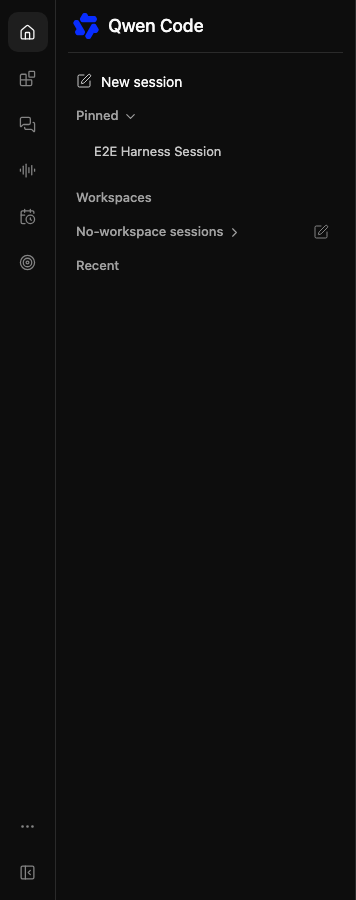

# Web Shell 守护进程适配器

## 目标

Web 聊天和 Web 终端客户端应通过守护进程 HTTP/SSE API 使用 `qwen serve`，并在客户端渲染对话记录。本地原生 TUI、channel 和 IDE 集成暂时保留现有的默认路径。

## 接口术语

本次术语更新涵盖侧边栏工作区标题和工作区创建/管理标签、常规会话创建操作（包括工作区概览和共享的 Managed 工作区行操作）、"最近"标题以及工作区 Memory 范围。在这些界面上，标签使用 **Workspaces / 工作区**、**New session / 新建会话** 和 **Recent / 最近**；单个目录支持的条目使用 **Workspace / 工作区**。Memory 范围使用 **Workspace / 工作区级**，保留中文范围级别后缀。

这不是产品范围的术语迁移。现有的 Managed-agent 页面文案和注册对话框文案（包括"工作空间"）、会话来源的 **Tasks / 任务** 标签、工作区执行提示、离线主机提示以及其他会话帮助文本保留其现有措辞。Agent、Skills、Workflow、MCP 和审批范围标签不在本次更新范围内。计划任务、待办事项、代理/工具执行、外部服务的项目和 Git worktree 保留其领域含义。**No-workspace sessions / 无工作区会话** 分组保留其名称和位置；其命名和层级结构是单独的后续工作。

现有的翻译键、SDK/API 字段、存储的标识符、配置键和运行时逻辑保持不变。从标签派生的 DOM 值确实会发生变化，包括对话框 `aria-label`、`data-web-shell-dialog-title` 和按钮可访问名称。匹配旧文本的自动化必须更新其选择器；例如，对话框标题现在是 **Add workspace**，而不是 **Add Workspace**。侧边栏触发器、对话框标题和非浏览提交按钮都使用 **Add workspace**；将基于文本的对话框选择器限定在 `[data-web-shell-dialog]` 范围内，以将其与背景触发器区分开来。"最近"标题及其区域名称继续共享相同的翻译键；单独的描述性区域标签不在本次仅限文案的更新范围内。

## 侧边栏类别标题

Pinned、Workspaces、No-workspace sessions 和 Recent 是同级的可折叠类别。其活动侧边栏标题使用相同的高度、间距、淡化文本和尾部展开箭头，包括悬停和键盘焦点显示规则。No-workspace sessions 保留其独立的已保存展开偏好和搜索行为。其标题在 Archived 设置中保留工作区条目呈现方式。

使用模拟守护进程响应的 Chromium 对比（悬停在已折叠的 No-workspace sessions 类别上）：

| 变更前                                                                   | 变更后                                                                  |
| ------------------------------------------------------------------------ | ----------------------------------------------------------------------- |
|  |  |

## 共享 UI 契约

使用 TypeScript SDK 的守护进程 UI 导出作为通用边界：

```ts
import {
  DaemonClient,
  DaemonSessionClient,
  createDaemonTranscriptStore,
  normalizeDaemonEvent,
} from ' @qwen-code/sdk/daemon';
```

职责划分如下：

- `DaemonClient` 负责处理守护进程 HTTP 路由。
- `DaemonSessionClient` 负责会话创建/附加以及 SSE 重放。
- `normalizeDaemonEvent()` 将守护进程线路事件转换为 UI 事件。
- `createDaemonTranscriptStore()` 将 UI 事件归约为对话记录块。

React 客户端可以使用 Web Shell 导出的绑定：

```tsx
import {
  DaemonSessionProvider,
  useActions,
  useConnection,
  usePendingPermissions,
  useTranscriptBlocks,
} from ' @qwen-code/web-shell/daemon-react-sdk';
```

最小 React 结构：

```tsx
function App() {
  return (
    <DaemonSessionProvider baseUrl="http://127.0.0.1:4170">
      <Transcript />
      <PromptBox />
    </DaemonSessionProvider>
  );
}

function Transcript() {
  const blocks = useTranscriptBlocks();
  return blocks.map((block) => <RenderBlock key={block.id} block={block} />);
}
```

该 Provider 会创建或附加一个守护进程会话，订阅 SSE，在 `DaemonSessionClient` 上保留最后一个事件 ID，并默认重新连接流。调用方可以通过 `autoReconnect={false}` 禁用此行为，用于测试或自定义连接管理。

### 删除选中的会话

会话概览支持删除超过 100 个选中的会话。它按所属工作区对选择进行分组，并通过每个工作区的客户端发送最多 100 个会话 ID 的顺序请求。如果后续请求失败，成功的删除仍会被计入，包括已删除当前会话的清理，而失败则显示在概览中。

批量大小遵循守护进程共享的 100-ID 请求验证，用于会话删除和归档，包括工作区限定路由。在删除期间，每个会话和请求失败会跨批次和工作区保留，无论其顺序如何。被拒绝的请求会停止其工作区中剩余的批次；其他工作区组仍会被处理。

### 移除编辑器附件

在桌面端 Web Shell 编辑器中，当文本内容为空且光标位于起始位置、没有选中文本时，按 Backspace 或 Delete 键会首先按照该按键已有的顺序移除一个可移除的上下文标签。如果没有剩余的可移除上下文标签，则移除最后一个文件附件；如果没有文件，则移除最后一张粘贴的图片。当文本内容非空时，文件和图片附件会被保留。附件也可以通过各自的移除按钮来删除。

## 浏览器部署形态

### 同源本地 POC

守护进程提供的页面可以直接调用守护进程，因为页面和 API 共享同一个源。这是本地 Web 聊天和 Web 终端验证的首选早期 POC 形态。

### 远程 Web 聊天 / Web 终端

生产环境的远程 Web 应用通常应通过 BFF（Backend-for-Frontend）通信。BFF 负责守护进程 URL、令牌、工作区路由和会话元数据，然后将浏览器安全的应用事件转发给浏览器。这样可以避免将 bearer 令牌存储在浏览器中，并让部署方决定用户有权访问哪个守护进程/工作区。

### 本地浏览器对接本地守护进程

独立的本地开发服务器与 `qwen serve` 跨源；它必须通过同源代理守护进程路由，或者由守护进程提供服务。守护进程会刻意拒绝任意浏览器 `Origin` 请求。

## 渲染职责

Web Shell 会在用户消息中对行首的斜杠标记（如 `/review`）进行高亮显示，使用与编辑器相同的蓝色加粗样式。高亮基于记录的文本派生，因此在重新打开会话时同样生效。这只是一种语法提示，并不代表命令存在或已执行。消息文本、可点击的 URL 和带注释的引用标签均会保留。

共享的对话记录模型是语义化的，而非视觉化的。UI 客户端自行决定如何渲染：

- 用户和助手消息块
- 可折叠的思考块
- 工具状态卡片
- Shell 输出块
- 权限请求控件
- 状态/错误/调试块

Web 终端是一个浏览器原生语义渲染器。它应具有类似终端的外观和体验——等宽布局、滚动历史、提示输入、快捷键和流式块——但它不是原始 PTY 代理，也不需要服务端 Ink 渲染。

## 合并安全性

- 原生 `qwen` TUI 保持直接且不变。
- `--acp`、channel 和 IDE 路径默认保持不变。
- SDK UI 核心是增量添加。
- Web Shell React 绑定是可选的，仅在导入它的客户端中运行。
- 已移除的守护进程 TUI 试验代码不应被视为产品迁移。

## 后续事项

- 保持守护进程提供的 Web Shell 与嵌入式 IDE 宿主行为一致。
- 继续基于对话记录块构建一等公民级别的聊天和终端渲染器。
- 仅在现有守护进程事件对稳定的浏览器 UI 行为而言过于底层时，才添加更丰富的类型化事件。
- 如果非 SDK 消费者需要将 UI 核心作为独立依赖，可考虑提供专用的 ` @qwen-code/daemon-ui-core` 包。